# BARCELONA: OPEN WORLD

Videojuego de mundo abierto, acción y conducción ambientado en una **Barcelona condensada pero geográficamente coherente**. Corre directamente en el navegador (Three.js, WebGL) sin compilación ni dependencias externas en tiempo de ejecución.

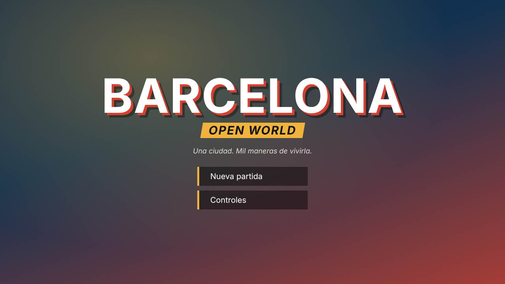

| | |
|---|---|
| 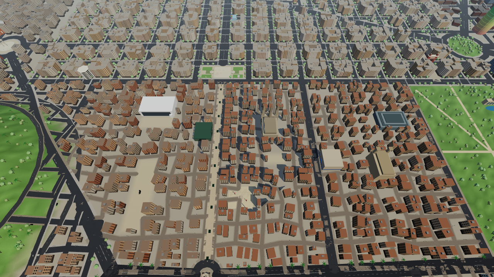 | 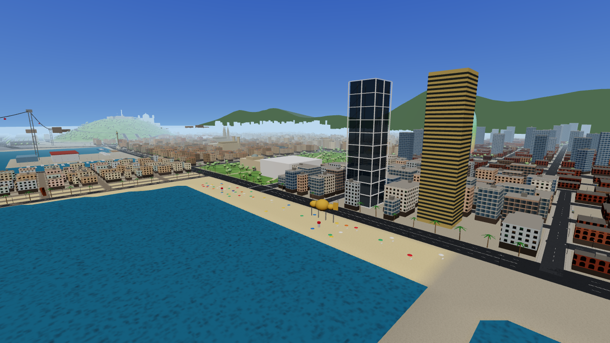 |
| 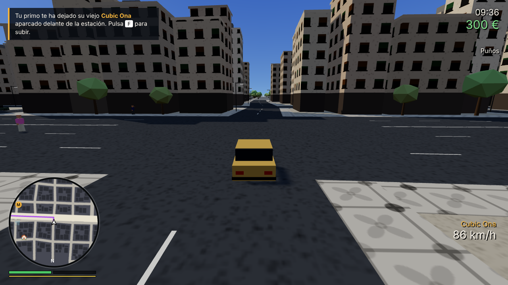 | 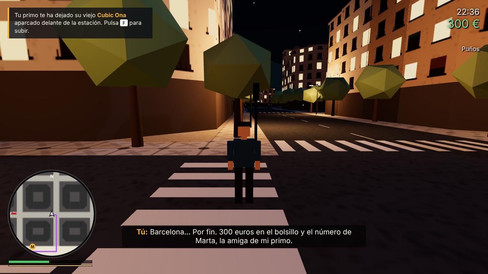 |
| 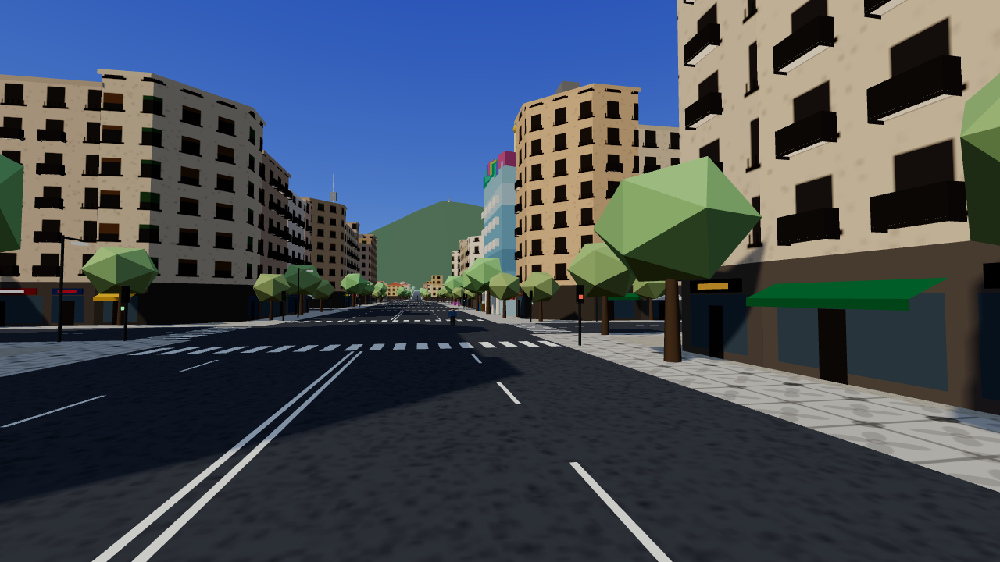 | 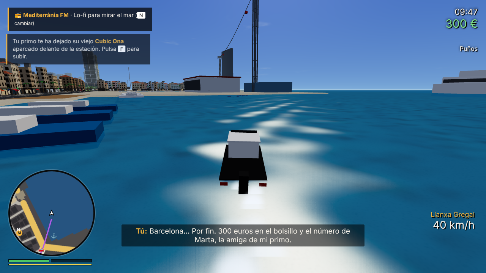 |
| 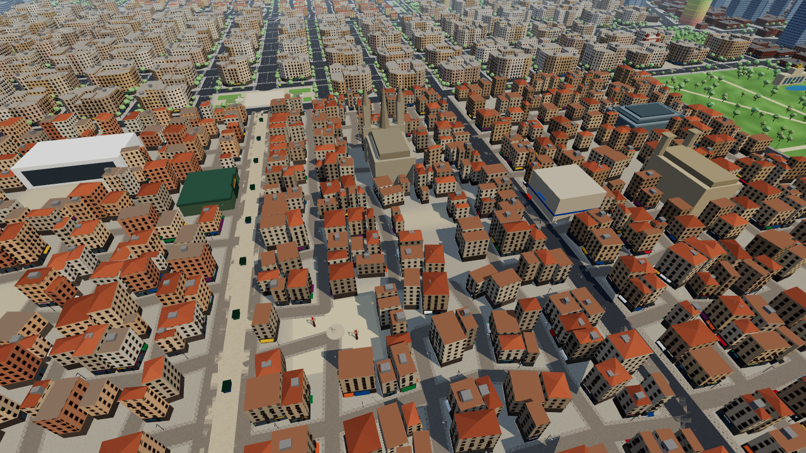 | 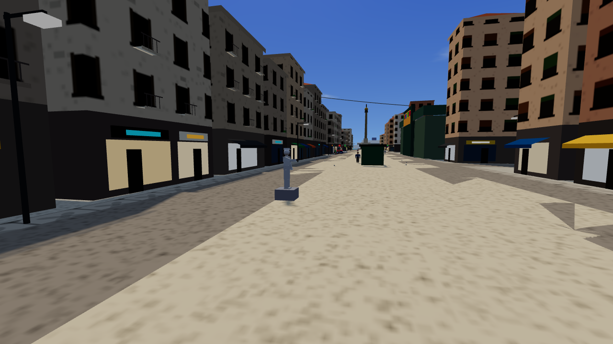 |
| 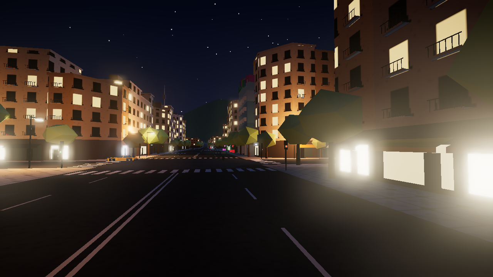 | 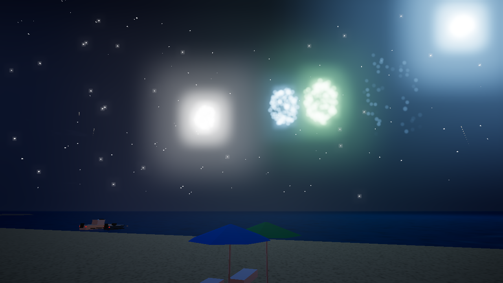 |

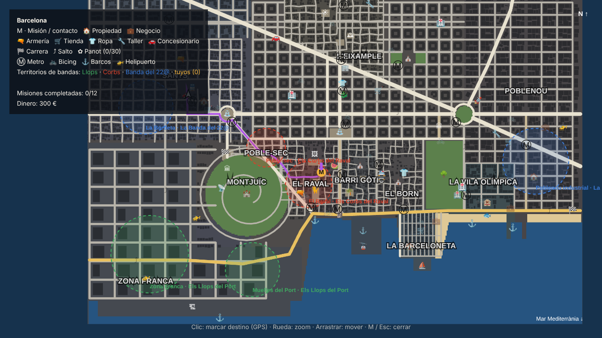

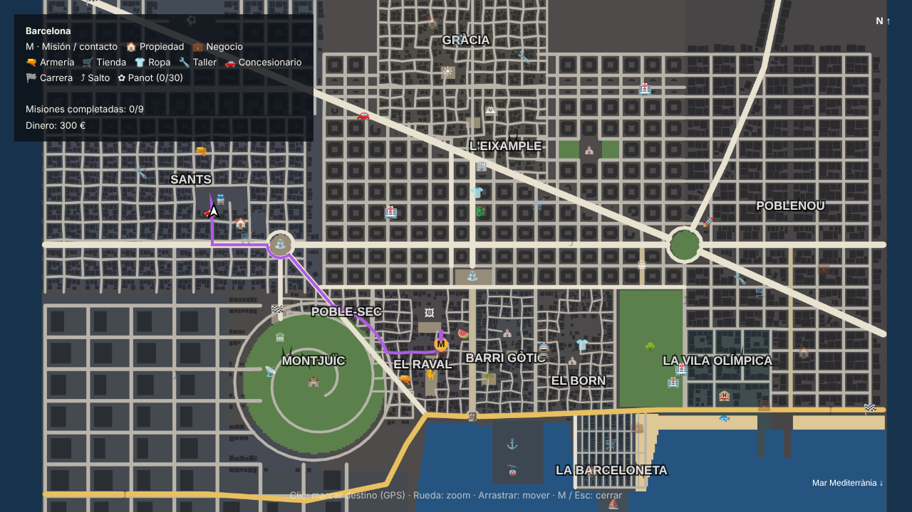

## Cómo jugar

**Opción fácil:** descarga el repositorio y abre `index.html` con doble clic (Chrome, Edge o Firefox). Carga el juego empaquetado `game.bundle.js`, que funciona sin servidor.

**Con servidor local:**
```bash
npm start            # o: python3 -m http.server 8080
# abre http://localhost:8080
```

Si la pantalla de carga muestra un error, normalmente es que WebGL está desactivado: activa la *aceleración por hardware* en los ajustes del navegador. Ojo: el juego no se puede ver desde la página de GitHub; hay que descargarlo (botón *Code → Download ZIP*) o servirlo.

**Desarrollo:** `index-dev.html` carga directamente los módulos de `src/` (necesita servidor HTTP). Tras modificar el código, regenera el paquete con `npm install && npm run build`.

### Controles

| Tecla | Acción |
|---|---|
| `W A S D` | Moverse / conducir |
| Ratón | Cámara (clic en la pantalla para capturar el ratón) |
| `Shift` | Esprintar (consume aguante) |
| `Espacio` | Saltar / freno de mano |
| `F` | Entrar, salir o **robar** un vehículo |
| `E` | Interactuar (contactos, tiendas, propiedades) |
| Clic izquierdo | Golpear / disparar |
| Clic derecho | Apuntar (también desde el coche: tiroteo en marcha) |
| `Q` · `1`-`7` | Cambiar de arma |
| `R` | Recargar |
| `H` / `L` / `G` | Claxon / luces / sirena (coche patrulla) |
| `N` | Cambiar emisora de radio |
| `Shift` (en coche) | Nitro, si está instalado |
| `Espacio` / `C` (helicóptero) | Subir / bajar |
| `J` | Trabajos: taxi, reparto en moto, vigilante |
| `M` | Mapa completo (clic = destino GPS) |
| `T` | Teléfono (contactos, taxi rápido) |
| `Esc` / `P` | Pausa, controles, estadísticas, ajustes |

Compatible con mando (sticks + gatillos).

## Qué hay en esta versión

**Ciudad** (~2,5 × 2 km de juego, ~4.500 edificios generados con lógica urbana):
- **L'Eixample** con la cuadrícula de Cerdà: manzanas octogonales con chaflanes y patio interior, Passeig de Gràcia, Rambla de Catalunya, Gran Via y la **Diagonal** cruzando en diagonal hasta Glòries.
- **Ciutat Vella**: Raval, Gòtic y Born como laberintos de calles estrechas con fachadas continuas, separados por **La Rambla** y **Via Laietana**.
- **Gràcia, Sants, Les Corts, Poble-sec, Poblenou (22@), Vila Olímpica, Barceloneta, Montjuïc y Zona Franca**, cada uno con trama, alturas, colores y estilo de fachada propios, todos conectados por la misma red viaria (sin pantallas de carga).
- Monumentos: Sagrada Família (con grúa y torre de Jesucristo iluminada), Arc de Triomf, Plaça de Catalunya, Mirador de Colom, Torre Glòries, Plaça d'Espanya y torres venecianas, Les Arenes, Palau Nacional con la Font Màgica animada, Castell de Montjuïc, Parc de la Ciutadella (cascada, lago, mamut, Parlament), Casa Batlló, La Pedrera, Catedral, Santa Maria del Mar, la Boqueria, MACBA, Gat del Raval, Mosaico de Miró, Park Güell, Hotel Arts y Torre Mapfre con el Peix d'Or, Hotel Vela, L'Estel Ferit, Port Vell con Maremagnum y cruceros, puerto de contenedores, **Telefèric del Port** en movimiento, Tibidabo y la torre de Collserola en el horizonte.
- Playa con sombrillas y socorristas, palmeras, plátanos en las aceras, farolas, contenedores de reciclaje, quioscos, semáforos funcionales y aceras de **panot**.
- Ciclo día/noche (24 min), sol mediterráneo, ventanas iluminadas, farolas con luz real, lluvia ocasional.

**Novedades de la versión 0.3:**
- **Postprocesado**: resplandor (bloom) en farolas, neones y escaparates, viñeta y gradación de color según la hora y el clima; la pantalla se tiñe de rojo con poca salud y parpadea en rojo y azul con la policía cerca.
- **Taller de tuning**: motor, frenos y suspensión, blindaje (3 niveles cada uno), **nitro** (`Shift` al conducir) y pintura a elegir. Las mejoras se guardan con el coche en el garaje.
- **Bicing**: 12 estaciones de bicicletas rojas y blancas (1 €), con animación de pedaleo.
- **Helicóptero pilotable** en 3 helipuertos (`Espacio` subir, `C` bajar, `W`/`S` avanzar, `A`/`D` girar) y **paracaídas** automático si saltas en el aire.
- **Bandas y territorios**: Els Llops del Port, Els Corbs del Raval y La Banda del 22@ controlan 6 zonas. Si atacas a una banda se desata una **guerra** de 3 oleadas; si ganas, el barrio es tuyo, tus hombres ocupan las esquinas y cobras protección cada día.
- **Habilidades** que suben con el uso: conducción (agarre, giro), puntería (precisión, recarga) y resistencia (salud máxima, aguante).
- **Controles policiales**: con 3 o más estrellas la policía corta la calle por delante.
- **Tormentas** con relámpagos y truenos, y **fuegos artificiales** sobre la playa de la Barceloneta algunas noches a las 23:00.

**Novedades de la versión 0.2:**
- Personajes articulados (rodillas, codos, manos, caras, barbas, gafas, pelo variado) y animaciones nuevas (charlar, sentarse, bailar, tocar la guitarra).
- Coches rediseñados (parabrisas inclinados, retrovisores, llantas, pasos de rueda) y **barcos** pilotables con física de agua y estela: Port Vell, Barceloneta, Port Olímpic y Zona Franca.
- Fachadas con **comercios** (escaparates iluminados de noche, toldos, rótulos, cruces verdes de farmacia), **balcones** de forja en el Eixample y el Gòtic, y **tejados de teja** en los barrios antiguos.
- Nubes que se mueven, mar con oleaje y reflejos, árboles y farolas en La Rambla.
- **Radio del coche** con música generada en tiempo real: rumba catalana, lo-fi mediterráneo, techno y cobla.
- **Metro**: 16 estaciones con bocas de metro y viaje rápido (2,55 €).
- **Vida en la calle**: bandadas de palomas que echan a volar, estatuas humanas, músicos y bailarines (puedes darles propina), grupos charlando y gente sentada en los bancos.
- **3 misiones nuevas** (12 en total): rescate en Poblenou, rally en Montjuïc y contrabando nocturno en lancha con persecución de una patrullera.
- **Calidad gráfica** baja/media/alta con ajuste automático si el juego va lento.

**Sistemas que interactúan entre sí:**
- **Tráfico** con IA por carriles: respeta semáforos, frena ante obstáculos, se atasca y maniobra, entra en pánico ante tiroteos. Taxis negro-amarillos, autobuses, motos, furgonetas…
- **Peatones** por barrio (turistas en el Gòtic y la Sagrada Família, bañistas en la playa, trabajadores en la Zona Franca): pasean, hablan en catalán/castellano, huyen, se acobardan, se rinden si les apuntas, esquivan coches o te plantan cara.
- **Física de conducción** arcade: derrapes, freno de mano, pendientes, saltos, daños, humo, fuego, explosiones en cadena, hundimiento en el mar.
- **Combate**: puños, bate, navaja, pistola, subfusil, escopeta y fusil; disparos con línea de visión, tiros a la cabeza, retroceso, recarga.
- **Policía** con testigos: los delitos se denuncian si alguien los ve. 1-5 estrellas, zona de búsqueda en el minimapa, patrullas que persiguen y embisten, agentes que te detienen o disparan, helicóptero con foco (derribable). Puedes huir, esconderte o repintar el coche.
- **Economía**: tiendas, armerías, ropa (cambiar de aspecto ayuda a despistar), talleres, concesionario, pisos francos (guardado, garaje), negocios con ingresos diarios, desguace para vender coches robados, atracos a comercios.
- **Historia original y no lineal**: 4 contactos (Marta, Quim, Inés y Dani "Llop") y 12 misiones que se desbloquean entre sí: repartos, cobros, persecuciones, robos de coches, sabotajes, escoltas y un tiroteo final en el castillo.
- **Actividades**: taxista, repartidor en moto, vigilante, 3 carreras callejeras (Montjuïc, Diagonal, Litoral), 6 saltos acrobáticos, 30 baldosas *panot* escondidas, sucesos aleatorios (carteristas, turistas perdidos, peleas).
- **Interfaz**: minimapa giratorio con ruta GPS, mapa completo con zoom y destinos, teléfono, estadísticas, ajustes de calidad y guardado en el navegador.

## Arquitectura

```
index.html, css/        Interfaz HTML/CSS (HUD, menús, mapa)
lib/three.module.min.js Three.js r170 (MIT) incluido localmente
src/main.js             Arranque y pantalla de título
src/game.js             Bucle principal y consultas compartidas
src/core/               Entrada, cámara, audio procedural, eventos, utilidades
src/world/              Terreno, trazado urbano, red viaria (grafo), colisiones,
                        edificios, monumentos, cielo
src/entities/           Jugador, humanoides, peatones, vehículos, IA de tráfico
src/systems/            Combate, policía, economía, misiones, actividades,
                        objetos recogibles, guardado
src/ui/hud.js           HUD, minimapa, mapa grande, GPS, menús
```

Detalles de diseño y hoja de ruta en [`docs/DISENO.md`](docs/DISENO.md).

Para depurar: `window.game` está expuesto en la consola (`game.player`, `game.police.level`, `game.missions.start('quim1')`…), y `?autostart=1` salta el menú.

## Créditos

Proyecto original. Personajes, historia, marcas de vehículos y misiones son ficticios. Los lugares están inspirados en la Barcelona real. Three.js © sus autores (licencia MIT, ver `lib/THREE_LICENSE`).
